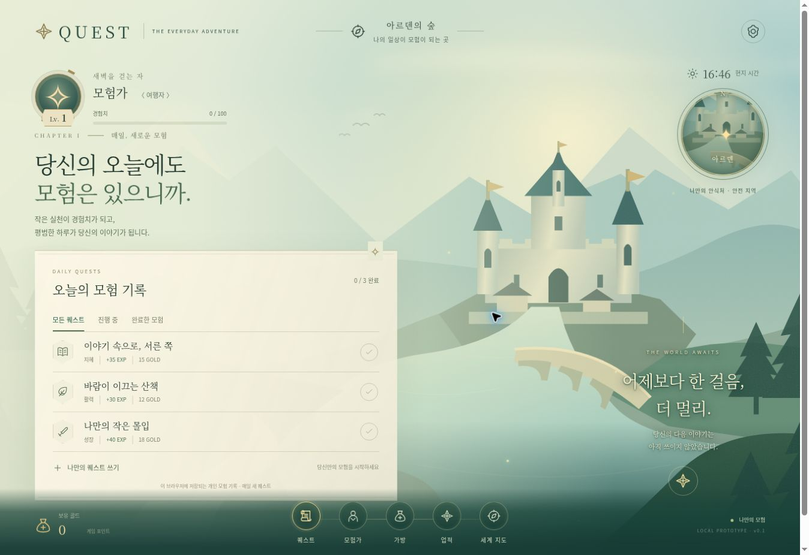

# UI 구현 변경 기록

## 변경 전의 실제 상태

- 기준 브랜치: `main`
- 기준 커밋: `4d077c51b05b002a8256b428b880d4943b2df985`
- 전체 트리: `README.md` 1개, 내용 `# Quest\nQuest_1\n`
- 브랜치 목록: `main` 1개
- 실행 가능한 화면, 기존 CSS·컴포넌트·데이터 모델 없음

따라서 변경 전 화면 이미지는 존재하지 않습니다. 아래 내용은 기존 화면과의 시각적 비교가 아니라, 빈 저장소에 추가한 구현 내역입니다.

## 핵심 파일: 전 → 후

| 파일 | 변경 전 | 구현 후 |
| --- | --- | --- |
| `public/index.html` | 없음 | 상태 HUD, 원형 지도, 모험 기록, 하단 메뉴, 공통 dialog |
| `public/styles.css` | 없음 | 밝은 중세 팔레트, 원형·문장형 UI, 행형 퀘스트, 반응형, 애니메이션, 동작 줄이기 |
| `public/app.js` | 없음 | 메뉴, 생성·완료·상세·필터, 보상 알림, 저장, 날짜 갱신, 설정 |
| `public/quest-state.js` | 없음 | 상태 검증, 일일 갱신, 중복 보상 방지, 레벨 계산 |
| `public/assets/world.svg` | 없음 | 외부 이미지 없이 작동하는 숲·성채·강·다리 일러스트 |
| `server.mjs` / `package.json` | 없음 | 패키지 설치 없이 실행하는 정적 서버와 검증 명령 |
| `tests/state.test.mjs` | 없음 | 보상, 레벨 경계, 저장·일일 갱신, 손상 데이터, 현지 날짜 테스트 |
| `README.md` | 저장소 제목 2줄 | 실행법, 구현 범위, 원본 부재, 데이터 저장 제한 명시 |

## 화면 구성 의도

화면 전체를 판타지 지역으로 사용하고 정보는 HUD로 배치했습니다. 반복되는 카드 대신 퀘스트를 한 장의 모험 기록에 행으로 정리했습니다. 모험가와 메뉴·지도는 원형, 갈래 아이콘은 문장형이며, 세부 정보는 필요할 때 dialog에 표시합니다. 검은 배경이나 과도한 금속 테두리 대신 밝은 청록 풍경과 상아색 종이로 중세 분위기를 구성했습니다.

## 검증 결과

- `npm run check`: JS 구문 검사 통과
- `npm test`: 상태 테스트 5개 통과
- 실제 브라우저: 기본 퀘스트 3개 완료 → 누적 105 EXP, Lv.2, 다음 레벨 경험치 5/100, 골드 45 확인
- 퀘스트 생성과 상세 확인, 새로고침 후 상태 유지 확인
- 모험가 / 가방 / 업적 / 세계 지도 / 환경 설정 dialog 확인
- 동작 끄기 → `motion-off` 적용 확인
- 테스트용 브라우저 기록 초기화 후 초기 화면 확인
- HTTP 미리보기에서 발견한 `crypto.randomUUID` 미지원 문제를 `getRandomValues` 대체 경로로 수정하고 생성 재검증

미리보기는 개발용입니다. GitHub의 기존 서비스 배포 설정이 없으므로 이 PR은 운영 배포를 구성하지 않습니다.
- 390px iframe 뷰포트에서 모바일 레이아웃 확인: 문서/뷰포트 너비 375px로 가로 넘침 없음 (스크롤바 제외)
- 모바일 고정 하단 메뉴, 축약 HUD, 세로 스크롤 확인

## 구현 화면

